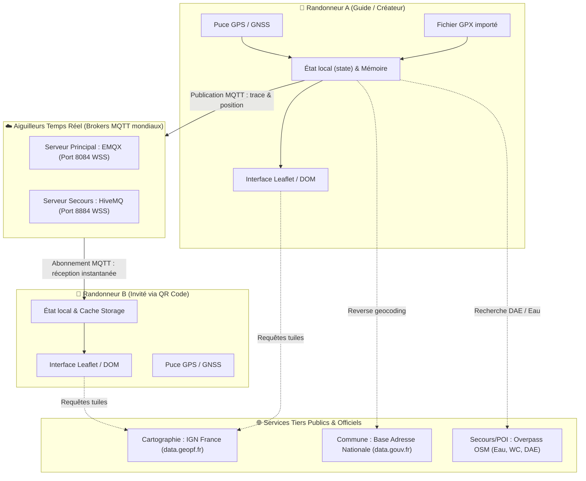
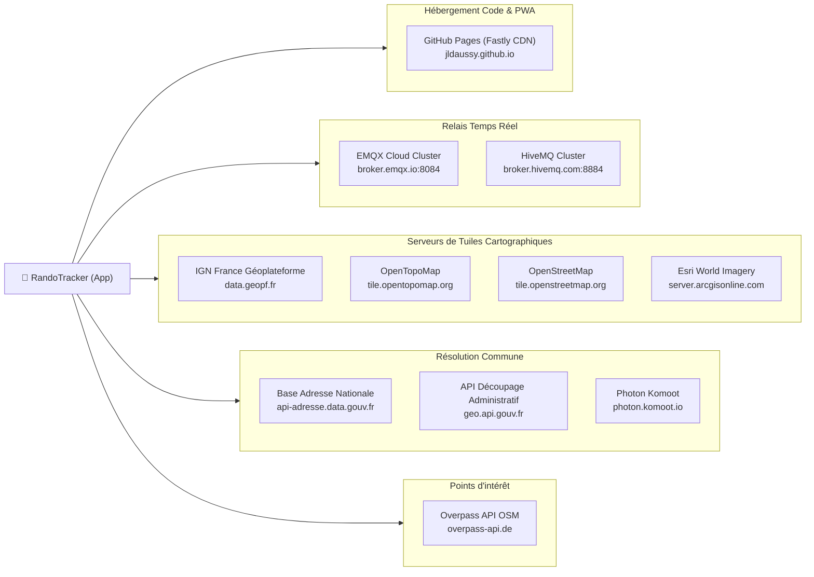
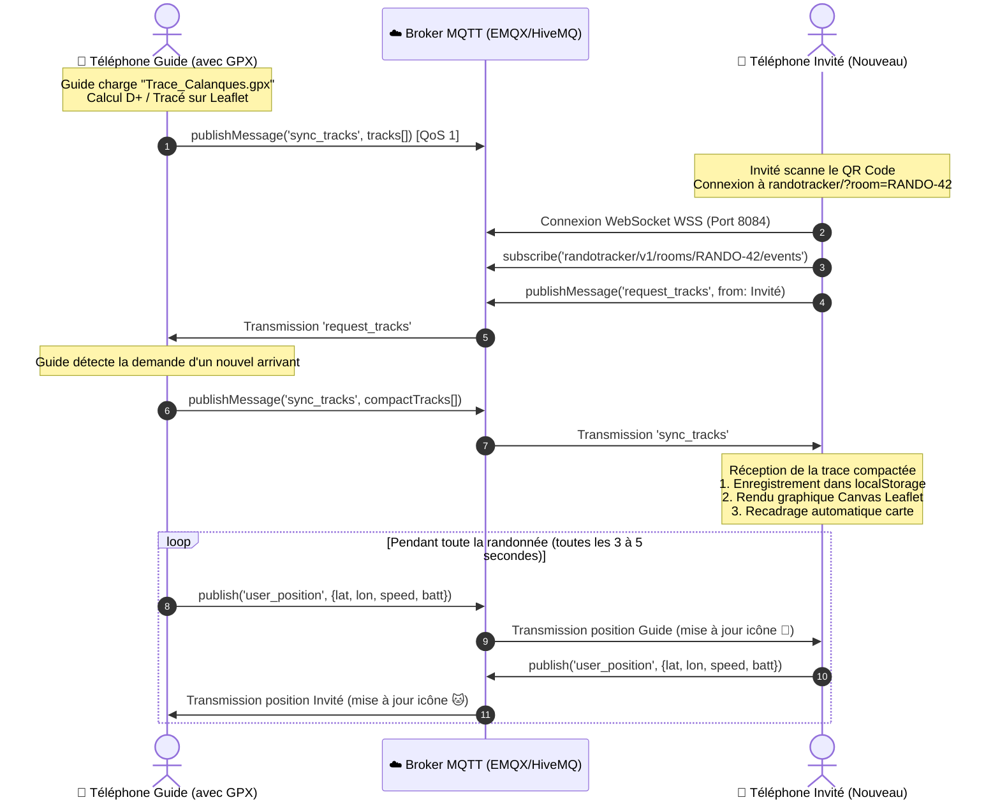

# 🧭 Fiche Technique & Architecture de RandoTracker

> **Version documentée :** v1.4.23 (Build 62 / Service Worker v111)  
> **Auteur & Concepteur :** Jean-Luc DAUSSY  
> **Nature du projet :** Application outdoor temps réel hybride (PWA Web & Android Native) sans base de données centrale ni compte utilisateur.

---

## 1. Vue d'ensemble de l'architecture

RandoTracker repose sur une architecture **décentralisée, éphémère et orientée client (*Client-Centric*)** :
* **Aucun serveur d'application propriétaire** : il n'y a ni base de données SQL/NoSQL (MySQL, MongoDB, Firebase...), ni serveur d'authentification qui stocke des profils, mots de passe ou historiques de parcours.
* **Hébergement statique distribué** : l'application Web est servie depuis le réseau de diffusion mondial (CDN) de GitHub Pages via HTTPS sécurisé.
* **Réseau de communication temps réel par courtage éphémère (*MQTT over WebSockets*)** : les smartphones des randonneurs d'un même salon communiquent directement entre eux par l'intermédiaire d'un relais de messages industriel en mémoire vive.



---

## 2. Cartographie du code : « Quel code est où ? »

Le projet s'organise en 4 couches complémentaires :

```
rando-tracker/
├── index.html                           # Structure sémantique DOM, modales et imports
├── styles.css                           # Design system Dark Outdoor, accessibilité tactile
├── app.js                               # Cœur applicatif (Logique, Cartographie, Réseau, Algorithmes)
├── sw.js                                # Service Worker PWA (Cache tuiles & mode hors-ligne)
└── android-project/                     # Enveloppe native Android haute performance
    └── app/src/main/
        ├── AndroidManifest.xml          # Déclaration des fonctionnalités et permissions
        └── java/fr/jldaussy/randotracker/
            ├── RandoMainActivity.java   # WebView native, pont JS et gestion du cache
            └── RandoGpsForegroundService.java # Maintien du GPS écran éteint dans la poche
```

### 2.1. `index.html` (Interface et structure DOM)
* **En-tête (`.app-header`)** : Logo, titre avec badge créateur *« by JLD »*, version applicative dynamique (`#header-app-version`), raccourcis d'accès rapide aux traces, fonds de carte et profil.
* **Barre de recherche haute (`#city-search-container`)** : Champ de saisie autocomplété pour chercher une commune, bouton de géolocalisation directe `🛰️` (`#btn-city-geoloc`), et barre de filtres POI de proximité (`🚰 Eau`, `🚻 Toilettes`, `⚡ DAE`).
* **Zone cartographique centrale (`#map`)** : Conteneur Leaflet plein écran avec boutons flottants FAB alignés verticalement (Boussole Google Maps `#map-compass-fab`, Pose de repère `#btn-add-waypoint-fab`, Recentrage intelligent `#btn-recenter-map`).
* **Tiroir de dénivelé (`#elevation-drawer`)** : Profil altimétrique Chart.js, scrubber interactif et minimap de défilement.
* **Modales et fenêtres volantes tactiles** :
  * Modale Secours 50/50 (`#emergency-modal`) avec dictée vocale, numéros d'urgence européens et transmission SMS pré-rempli.
  * Tiroir des participants (`#users-panel`) avec liste dynamique, rôles, batterie, état de marche et bouton d'invitation QR code.
  * Modales de traces (`#tracks-modal`), fonds de carte (`#layer-modal`), profil (`#profile-modal`), salons (`#room-modal`) et repères (`#waypoint-modal`).
* **Barre de navigation inférieure (`.app-bottom-nav`)** : 4 touches surdimensionnées à frappe aisée avec gants (`SOS`, `Mon GPS`, `Traces`, `Groupe`).

### 2.2. `styles.css` (Design system outdoor haute lisibilité)
* **Charte sombre à haut contraste** : Fond noir bleuté profond (`#020617`, `#0f172a`), bordures émeraude (`#10b981`), accents ciel (`#38bdf8`) et alertes rouge vif (`#ef4444`).
* **Protection tactile grand froid** : Application de `touch-action: manipulation` pour éliminer le délai de double-tap de 300 ms sur mobile.
* **Zones tactiles étendues** : Pseudo-éléments `::before` garantissant une surface de frappe minimale de 46 px même pour les petites icônes.
* **Moteur de fenêtres flottantes** : Gestion du déplacement au doigt (`.popup-drag-bar`, `cursor-grab`) et du redimensionnement dynamique (`adjustPopupZoom`).
* **Animation du suivi actif** : Classe `.map-fab-btn.is-following` avec halo vert pulsant pour signaler visuellement le maintien de la carte au centre.

### 2.3. `app.js` (Moteur logique complet — ~9 600 lignes)
Le script JavaScript est structuré en modules fonctionnels indépendants :

| Module dans `app.js` | Fonctions principales | Rôle et mécanisme |
| :--- | :--- | :--- |
| **État global (`state`)** | `state = { ... }` | Objet central unique contenant l'utilisateur courant (`myUser`), les randonneurs distants (`otherUsers`), les traces, les repères et les calques. |
| **Moteur cartographique** | `initMap()`, `setMapLayer()`, `updateAllTrackOffsets()` | Initialise Leaflet avec moteur Canvas ultra-rapide. Gère le décalage parallèle des tronçons communs de traces (`polylineoffset`). |
| **Géolocalisation & Suivi** | `startGpsWatch()`, `geolocateCurrentLocation()`, `recenterMapOnUser()` | Interroge l'API W3C Geolocation (`watchPosition`). Anime le déplacement fluide du marqueur et assure le suivi automatique intelligent (Option 1). |
| **Reverse-Géocodage** | `fetchCityName(lat, lon)` | Résout la commune exacte via la Base Adresse Nationale (BAN) puis `geo.api.gouv.fr`. Élimine tout repli générique (*"France"*). |
| **Calculs géodésiques** | `calculateDistance()`, `formatDD()`, `formatDMS()`, `formatUTM()` | Calcule les distances orthodromiques (Haversine), convertit les coordonnées en Degrés Décimaux, Degrés Minutes Secondes et Projection UTM WGS84 (fuseaux 30, 31, 32). |
| **Filtres POI de proximité** | `fetchNearbyPoi()`, `updateNearbyPoiDistances()` | Interroge l'API Overpass (OpenStreetMap) dans un rayon de 10 km autour de la position pour lister points d'eau potable, sanitaires et défibrillateurs (DAE). |
| **Synchronisation réseau** | `initRealtimeSync()`, `publishMessage()`, `handleIncomingMessage()` | Établit la liaison WebSocket MQTT, gère le basculement entre serveurs, encode et décode les paquets JSON du salon. |
| **Gestion des traces GPX** | `handleGpxFileInput()`, `parseGpxXml()`, `prepareTracksForMqtt()` | Parse les fichiers GPX en mémoire, calcule distance/dénivelé cumulé, et sous-échantillonne intelligemment la trace pour la diffusion (< 30 Ko). |
| **Secours & Mode Poche** | `updateEmergencyModalGpsData()`, `enterPocketMode()`, `requestWakeLock()` | Maintient l'écran allumé (Screen WakeLock), prépare le SMS d'urgence formaté et protège contre les appuis involontaires dans la poche. |

### 2.4. `sw.js` (Service Worker PWA)
* **Stratégie Cache-First pour les tuiles de cartes** : Les tuiles téléchargées (IGN, OpenTopoMap, OSM) sont automatiquement enregistrées dans le cache `rando-tiles-v1`. Dès lors, toute zone cartographique consultée une fois s'affiche à **0 ms** et reste accessible sans connexion Internet.
* **Stratégie Network-First pour l'application** : Tente de récupérer la dernière version des scripts et styles (`app.js?v=111`, `styles.css?v=111`), avec repli immédiat sur le cache hors-ligne `rando-tracker-v111` en cas d'absence de réseau.

### 2.5. `android-project/` (Application native Android)
* **`RandoMainActivity.java`** :
  * Héberge une `WebView` plein écran optimisée avec accélération matérielle.
  * Intercepte les autorisations géolocalisation (`onGeolocationPermissionsShowPrompt`) et caméra QR code (`onPermissionRequest`) pour les accorder de manière fluide.
  * Détecte les mises à jour de version (`versionCode`) et purge automatiquement le cache interne de la WebView pour garantir le chargement immédiat du dernier code.
  * Gère les Intent Android pour rejoindre un salon directement par URL (`randotracker://?room=...`).
* **`RandoGpsForegroundService.java`** :
  * Service d'arrière-plan avec notification persistante dans la barre d'état.
  * Empêche Android de tuer la géolocalisation lorsque le randonneur verrouille son smartphone ou range l'appareil dans sa poche.
  * Respecte scrupuleusement les exigences du Google Play Store (absence de permissions intrusives, sécurité SSL).

---

## 3. L'écosystème de serveurs tiers : « Quels serveurs sont utilisés ? »

RandoTracker s'appuie sur une sélection de services tiers réputés, stables et sécurisés :



### Inventaire technique détaillé

| Domaine | Service / Serveur | URL d'accès | Protocole | Fonction et persistance |
| :--- | :--- | :--- | :--- | :--- |
| **Hébergement Web** | **GitHub Pages** (Fastly Global CDN) | `https://jldaussy.github.io/randotracker/` | HTTPS / HTTP2 | Délivre les fichiers statiques HTML, CSS, JS, icônes et PDF. Cache géré par en-têtes HTTP. |
| **Relais Temps Réel (Principal)** | **EMQX Public Broker** (EMQ Technologies) | `wss://broker.emqx.io:8084/mqtt` | WSS (WebSocket SSL) | Aiguille les messages de position et de trace. **Aucune persistance** (mémoire vive pure, `clean: true`). |
| **Relais Temps Réel (Secours)** | **HiveMQ Public Broker** (HiveMQ GmbH, Allemagne) | `wss://broker.hivemq.com:8884/mqtt` | WSS (WebSocket SSL) | Relais de basculement automatique en cas d'indisponibilité d'EMQX. Mémoire vive pure. |
| **Cartographie France** | **IGN France (Géoplateforme)** | `https://data.geopf.fr/wmts?...` | HTTPS | Cartes officielles TOP 25 (SCAN 25) et Plan IGN. Mise en cache local dans `rando-tiles-v1`. |
| **Cartographie Rando Mondiale** | **OpenTopoMap** | `https://{s}.tile.opentopomap.org/{z}/{x}/{y}.png` | HTTPS | Courbes de niveau mondiales et sentiers balisés. |
| **Cartographie Satellite** | **Esri World Imagery** | `https://server.arcgisonline.com/ArcGIS/rest/...` | HTTPS | Vues aériennes haute résolution mondiales. |
| **Commune (France)** | **Base Adresse Nationale (BAN)** | `https://api-adresse.data.gouv.fr/reverse/?lat=...&lon=...` | HTTPS / REST | Résolution officielle de la commune et du département français. |
| **Commune (Secours France)** | **API Découpage Administratif** | `https://geo.api.gouv.fr/communes?lat=...&lon=...` | HTTPS / REST | Repli officiel français si la BAN est indisponible. |
| **Commune (International)** | **Photon Komoot** | `https://photon.komoot.io/reverse?lat=...&lon=...` | HTTPS / REST | Résolution mondiale des lieux-dits, parcs naturels et villages OSM. |
| **Points d'Intérêt (POI)** | **Overpass API** (OpenStreetMap Allemagne) | `https://overpass-api.de/api/interpreter` | HTTPS / POST | Recherche spatiale dynamique des points d'eau (`drinking_water`), toilettes (`toilets`) et DAE (`defibrillator`). |

---

## 4. Modalités de transmission des données dans le salon

### 4.1. Identification et canal du salon
* À l'initialisation, chaque session possède un code de salon (`roomCode`), soit généré aléatoirement (`RANDO-XXXXX`), soit transmis via l'URL (`?room=MON-GROUPE`).
* Tous les membres du groupe souscrivent au topic MQTT dédié :
  ```
  randotracker/v1/rooms/{roomCode}/events
  ```

### 4.2. Qualité de Service (QoS) adaptée au réseau outdoor
RandoTracker applique une gestion différenciée de la priorité réseau :
* **QoS 0 (*At most once*)** pour les coordonnées GPS récurrentes : envoi ultra-rapide sans accusé de réception pour ne pas saturer la batterie ni la bande passante. Si un point est manqué en marchant, le suivant arrive 3 secondes après.
* **QoS 1 (*At least once*)** pour les événements critiques : les traces GPX (`sync_tracks`), les alertes d'urgence (`group_sos_alert`) et les messages de groupe (`broadcast_announcement`) exigent un accusé de réception du broker pour garantir qu'aucun message vital n'est perdu.

### 4.3. Les formats de messages échangés (Payloads JSON)

#### 1. Annonce d'arrivée d'un randonneur (`user_joined`)
```json
{
  "type": "user_joined",
  "user": {
    "id": "usr_8f2a1c",
    "name": "Jean-Luc",
    "role": "Guide de tête",
    "icon": "🥾",
    "color": "#10b981",
    "battery": 88
  }
}
```

#### 2. Position GPS temps réel (`user_position`)
Diffusé toutes les 3 à 5 secondes pendant la marche :
```json
{
  "type": "user_position",
  "user": {
    "id": "usr_8f2a1c",
    "lat": 43.12246,
    "lon": 5.77950,
    "ele": 72,
    "speed": 3.4,
    "movingAvgSpeed": 3.8,
    "battery": 86,
    "accuracy": 5,
    "cityName": "Sanary-sur-Mer (83)",
    "lastSeen": 1774358400000
  }
}
```

#### 3. Demande de parcours par un nouvel arrivant (`request_tracks`)
```json
{
  "type": "request_tracks",
  "from": "usr_9b3e41"
}
```

#### 4. Synchronisation de la trace allégée (`sync_tracks`)
```json
{
  "type": "sync_tracks",
  "from": "usr_8f2a1c",
  "tracks": [
    {
      "id": "trk_1774358000",
      "name": "Sentier du Littoral",
      "totalDistance": 11.8,
      "totalEleGain": 320,
      "totalEleLoss": 315,
      "color": { "name": "Émeraude", "hex": "#10b981" },
      "points": [
        { "lat": 43.12246, "lon": 5.77950, "ele": 72 },
        { "lat": 43.12310, "lon": 5.78012, "ele": 75 }
      ]
    }
  ]
}
```

#### 5. Alerte d'Urgence SOS (`group_sos_alert`)
```json
{
  "type": "group_sos_alert",
  "user": {
    "id": "usr_8f2a1c",
    "name": "Jean-Luc",
    "lat": 43.12246,
    "lon": 5.77950,
    "ele": 72,
    "cityName": "Sanary-sur-Mer (83)",
    "utm": "31T E 726108 N 4778165"
  }
}
```

---

## 5. Déroulement complet de la synchronisation (Séquence)

Voici ce qui se passe chronologiquement quand un randonneur invité rejoint le salon :



---

## 6. Résilience aux zones blanches & mode hors-ligne

En montagne, la perte temporaire de signal mobile est inévitable. RandoTracker intègre des protections spécifiques :

1. **Persistance locale absolue** :
   * Une trace GPX reçue est immédiatement sauvée dans le `localStorage` du smartphone de l'invité.
   * Si l'invité ferme son navigateur ou si l'appareil redémarre en pleine forêt, la trace se recharge instantanément au lancement sans solliciter le réseau.
2. **Indication visuelle de perte de liaison (*Zone Blanche*)** :
   * Chaque position reçue horodate le participant (`lastSeen`).
   * Si aucun paquet n'est reçu pendant **plus de 2 minutes** :
     * Le marqueur du randonneur passe en semi-transparence.
     * Le badge affiche : `🌲 Zone blanche (dernière pos. il y a X min)`.
     * Son dernier emplacement connu reste épinglé sur la carte.
3. **Reconnexion transparente et immédiate** :
   * Le client `MQTT.js` tente des reconnexions périodiques en tâche de fond (`reconnectPeriod: 2000`).
   * Dès que le randonneur franchit un col ou retrouve 2 secondes de couverture 4G/3G, la connexion se rétablit sans action de l'utilisateur et renvoie sa position actuelle.

---

## 7. Sécurité et confidentialité

* **Chiffrement de bout en bout en transit** : Tout le trafic transite par des liaisons chiffrées **TLS / SSL (WSS)**, empêchant l'interception de coordonnées sur les réseaux publics ou Wi-Fi.
* **Aucun stockage de données nominatives** : Les brokers MQTT utilisés fonctionnent en mémoire volatile pure (*in-memory*). Aucun nom, aucun fichier GPX, aucun historique GPS n'est inscrit sur un disque dur externe.
* **Salons éphémères et cloisonnés** : Les topics sont cloisonnés par le code aléatoire du salon. Dès la sortie du salon ou à l'expiration de la durée choisie (8 heures par défaut), le canal est abandonné.
* **Respect de la vie privée sur smartphone** : RandoTracker n'accède à aucune donnée personnelle de l'appareil (ni carnet de contacts, ni photos, ni identifiants publicitaires). Seules les autorisations matérielles indispensables (**Position GPS** et **Caméra pour scanner le QR Code**) sont sollicitées.
